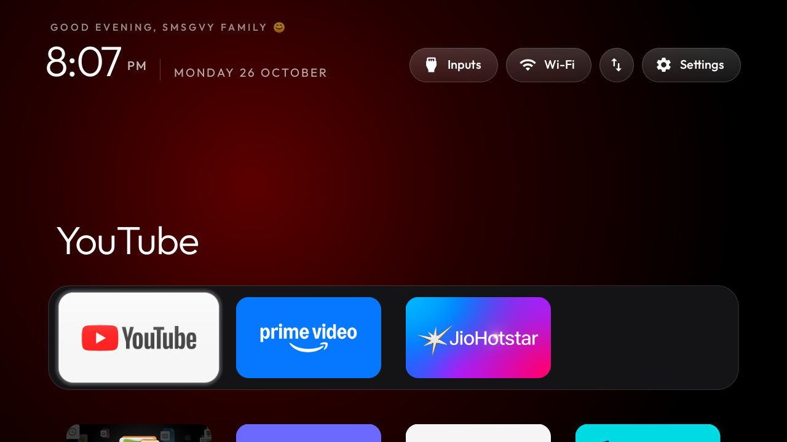
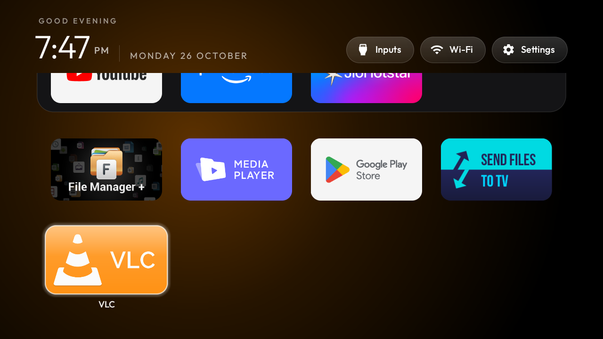
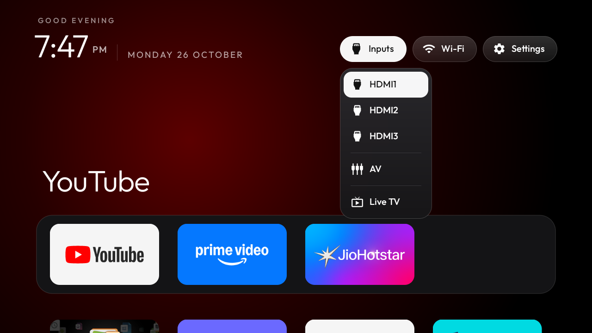
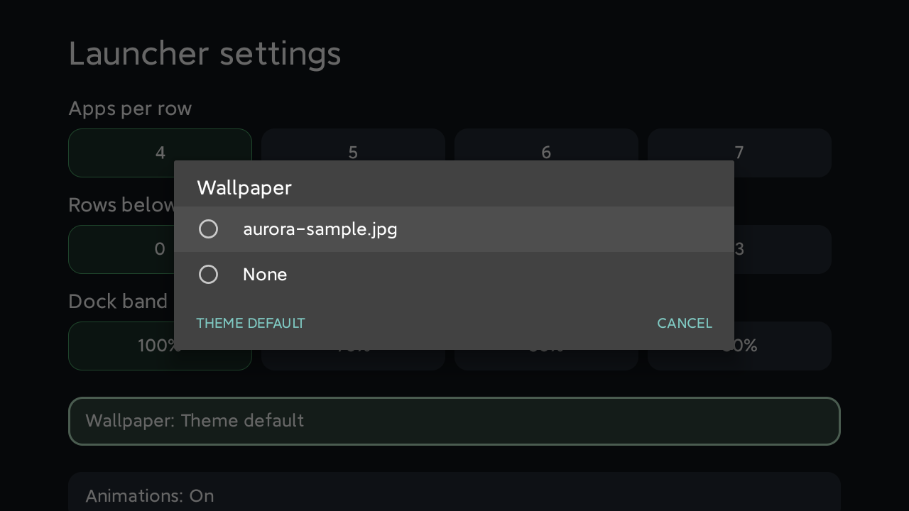

# Mi TV Clean Home

**An Apple TV style home screen and a de-bloated Xiaomi Mi TV 4A Pro / 4C Pro (MiTV-AXSO0, Android TV 9),
built on [Gathin23/cleanyourtv](https://github.com/Gathin23/cleanyourtv).**

No ads, no PatchWall, no Xiaomi telemetry: a pitch-black home with a clock and greeting, a dock of your
favourite apps, a scrolling app grid, and an Inputs menu for HDMI, AV and Live TV. Everything is reversible.

| Home | App grid | Inputs |
|---|---|---|
|  |  |  |

## Credit

All the heavy lifting is [**cleanyourtv**](https://github.com/Gathin23/cleanyourtv) by
[Gathin](https://github.com/Gathin23) (MIT licence): the ADB client (`tools/tv.py`), the safe `disable` /
`restore` scripts with their Home and core-package guards, the reference launcher (`com.gathin.tvhome`) and the
tested [MiTV-AXSO0 list](https://github.com/Gathin23/cleanyourtv/blob/main/examples/xiaomi-mitv-axso0/debloat.txt).

This repo does **not** copy that code. It holds one family's choices on top of it: the debloat batches, the
launcher `config.xml`, a few Windows helper scripts and the notes from doing it on a real TV. `scripts\setup.ps1`
clones upstream, pinned to the commit this was tested on (`f592b6d`, 26 Oct 2026).

## What you get

- **Debloat** (6 small batches, disabled for user 0, never uninstalled): Xiaomi/Google telemetry, PatchWall and
  recommendation rows, partner auto-installs, Xiaomi cleaner/handbook/legal screens, Mi Cast, Miracast, the
  Xiaomi firmware updater, Mi Music, Play Games, Play Movies, Mi Gallery, YouTube Music, Netflix and the Mi
  screensaver. Google Assistant, Chromecast, Play Store, Live TV and HDMI stay.
- **New Home** (upstream launcher, this `config.xml`): dock of YouTube, Prime Video, JioHotstar and one free slot,
  greeting "Good evening, SMSGVY Family 😊", reorder button and hold-OK tile menu for editing the dock on the TV,
  Live TV app set to `com.android.tv`.
- **Extras**: ad-blocking Private DNS (AdGuard), Location on so the Wi-Fi pill shows the network name, the
  Android system wallpaper replaced with black (it flashed at power-on and behind Settings), and your own
  wallpapers from a USB stick or a PC.

## Repo layout

```
mi-tv-clean-home/
├── README.md                    this file
├── LICENSE                      MIT (this repo) + upstream credit
├── launcher/
│   ├── config.xml               the full launcher config used here (copied over upstream's at build time)
│   └── config.diff              exactly what changed versus upstream's default config.xml
├── lists/                       debloat batches, applied in order (01 … 06)
├── scripts/
│   ├── setup.ps1                clone upstream (pinned) + install its ADB client in a venv
│   ├── debloat.ps1              back up the TV, then disable each list with a screenshot in between
│   ├── build-and-install.ps1    build the launcher with launcher/config.xml and make it Home
│   ├── add-wallpaper.ps1        push your pictures to the launcher's wallpaper list
│   ├── set-system-wallpaper.ps1 replace Android's own wallpaper (black by default)
│   └── restore.ps1              undo everything
├── docs/
│   ├── WALKTHROUGH.md           the whole session, step by step, with the commands
│   ├── BUILD-ON-WINDOWS.md      JDK 17 + Android SDK without Android Studio, and the Gradle fixes
│   └── TROUBLESHOOTING.md       what went wrong on this TV and how it was fixed
└── screenshots/                 pulled from the TV
```

`cleanyourtv/`, `backup/`, `shots/` and `toolchain/` are created locally and are git-ignored.

## Quick start (Windows, PowerShell)

You need Git, Python 3 and the TV on the same Wi-Fi as the PC.

1. **On the TV**: Settings > Device Preferences > About > press *Build* 7 times, then Developer options >
   *USB debugging* on. The TV opens network ADB on port 5555.
2. **Clone and set up**:
   ```powershell
   git clone https://github.com/venketraj/mi-tv-clean-home
   cd mi-tv-clean-home
   .\scripts\setup.ps1
   $env:TV_HOST = '<tv ip>'        # Settings > Network on the TV shows it
   function tv { & .\cleanyourtv\tools\venv\Scripts\python.exe .\cleanyourtv\tools\tv.py @args }
   tv --probe                      # model and Android version
   ```
   The first command that reaches the TV makes it ask **"Allow USB debugging?"**: tick *Always allow*, OK.
3. **Pick what to keep**: open the files in `lists\` and put `#` in front of any app you use (Netflix, Mi Cast,
   the updater …). Then:
   ```powershell
   .\scripts\debloat.ps1
   ```
4. **Choose your dock** in `launcher\config.xml` (`dock_apps`, `columns`, `greeting_name`; see below), install the
   build tools once (`docs\BUILD-ON-WINDOWS.md`), then:
   ```powershell
   .\scripts\build-and-install.ps1
   ```
5. **Optional extras**:
   ```powershell
   # Ad-blocking DNS (does not block YouTube ads; skip it if your router already filters DNS)
   tv 'settings put global private_dns_specifier dns.adguard-dns.com'
   tv 'settings put global private_dns_mode hostname'
   # Wi-Fi name on the Home pill (Android 9 needs Location for it)
   tv 'settings put secure location_mode 3'
   # Black system wallpaper instead of whatever was set before
   .\scripts\set-system-wallpaper.ps1
   ```
6. **When done, close ADB**: Developer options > *USB debugging* off and *Revoke USB debugging authorisations*,
   then reboot. Check with `.\cleanyourtv\tools\venv\Scripts\python.exe .\cleanyourtv\tools\adb-closed.py <tv ip>`.
   (`tv` below means the function from step 2.)
   Port 5555 is unencrypted; don't leave it open.

## Customising

**Dock on the TV, no PC needed**: select the ⇅ button in the top bar (or hold OK on any tile > *Move*, or hold
OK on *Settings* > *Edit dock*). OK picks an app up, arrows move it into or out of the dock, Back drops it,
Back again finishes.

**Dock from the PC**: in `launcher\config.xml`

| Key | What it does | Here |
|---|---|---|
| `dock_apps` | dock apps, in order, by package name | YouTube, Prime Video, JioHotstar |
| `columns` | dock slots and grid width (4–7) | 4 |
| `fill_dock` | `false` leaves free dock slots empty, `true` fills them from the grid | false |
| `greeting_name` | name after "Good morning/evening" (empty = greeting only) | SMSGVY Family 😊 |
| `tile_menu`, `reorder_button` | hold-OK tile menu and the ⇅ button | true |
| `live_tv_package`, `hidden_apps` | the TV's Live TV app, hidden from the grid | com.android.tv |

Find package names with `tv 'pm list packages -3'`. Rebuild with `.\scripts\build-and-install.ps1`.
Every other key is documented in upstream's `config.xml` and `themes/README.md`.

**Wallpaper**: copy pictures to the TV folder `Android/data/com.gathin.tvhome/files/wallpapers/` (File Manager+
from a USB stick, or `.\scripts\add-wallpaper.ps1 C:\Photos\pic.jpg`), then on the TV hold OK on *Settings* >
*Launcher settings* > *Wallpaper*. *None* = black; *Theme default* rotates through all of them.


**Re-enable one app**: `tv 'pm enable --user 0 com.netflix.ninja'` (names are in `lists\`).
**Undo everything**: `.\scripts\restore.ps1`. **DNS off**: `tv 'settings put global private_dns_mode opportunistic'`.

## Good to know

- Power-on: this firmware returns to the last source (Live TV / HDMI) by itself; Home is one press away.
- TV Settings is Android's own side panel and always draws over the system wallpaper, not over the HDMI
  picture. That's why `set-system-wallpaper.ps1` exists.
- Disabled packages stay disabled after a reboot on this firmware (checked).
- Other Mi TV models: start from upstream's `examples/` folder for your model instead of `lists\`.

## Licence

MIT, see [LICENSE](LICENSE). Upstream cleanyourtv is MIT © 2026 Gathin; its code is fetched by `setup.ps1`,
not redistributed here. Not affiliated with Xiaomi, Google or Apple.
